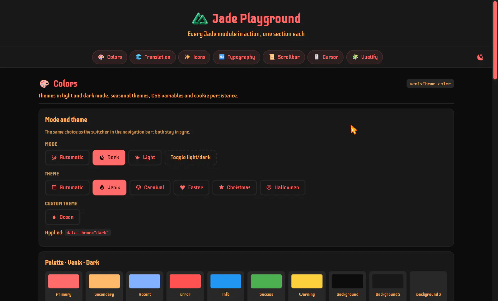
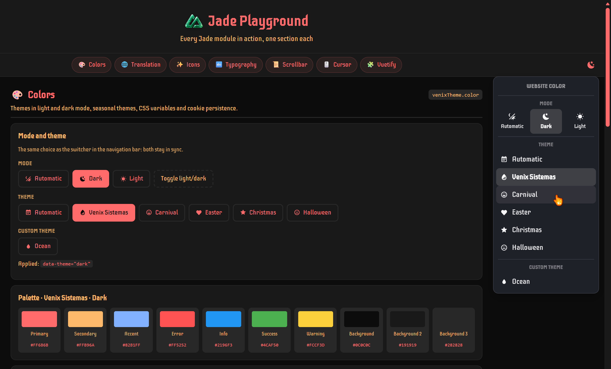
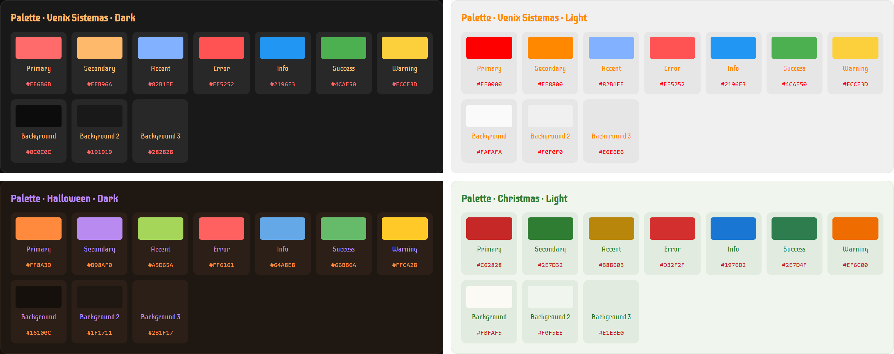
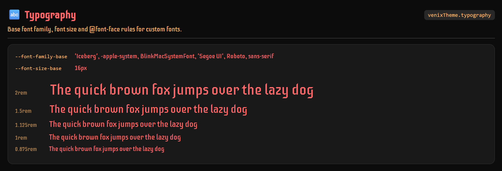
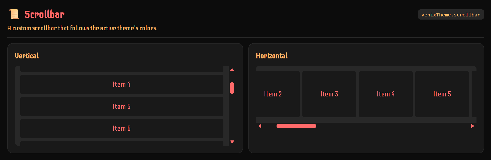
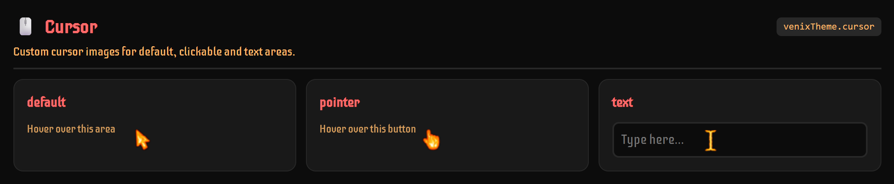
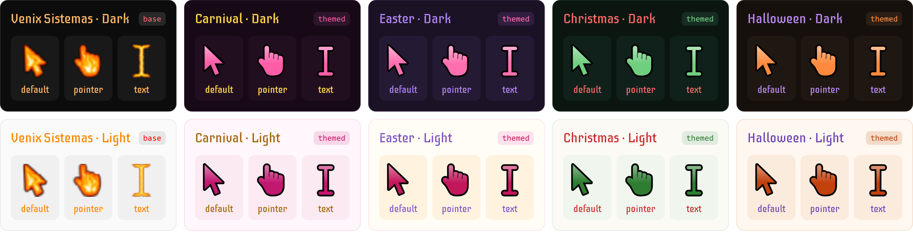
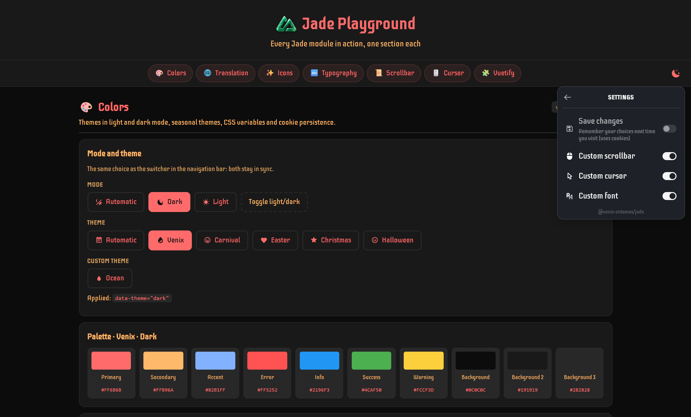
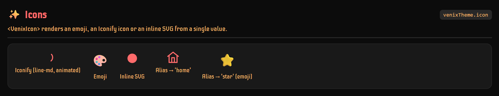

<p align="center">
  
</p>

<h1 align="center">Jade</h1>

<p align="center">
  <code>@venix-sistemas/jade</code>
</p>

<p align="center">
  <a href="https://www.npmjs.com/package/@venix-sistemas/jade"></a>
  <a href="https://opensource.org/licenses/MIT"></a>
</p>

<p align="center">
  The UI foundation for Nuxt applications, in a single module: color themes (including seasonal ones),<br>
  typography, scrollbar, cursor, icons and interface translations, with UnoCSS and Vuetify integrations.
</p>

<p align="center">
  
</p>

## Features

* 🎨 **Color customization**, with dark and light themes included
* 🌗 **Theme and mode picked separately**: any theme (Venix, Carnival, Christmas…) in light or dark, each following the system or fixed
* 🎃 **Seasonal themes**: Carnival, Halloween, Christmas and more
* 📝 **Typography and font faces customization**
* 📜 **Scrollbar customization**
* 🖱️ **Cursor customization**
* 🎛️ **Ready-made theme switcher**: accessible, phone-friendly, with no UI kit dependency
* 🖥️ **System preference detection**, including seasonal themes by date
* 💾 **Cookie-consent-aware persistence**: nothing is written until the user opts in
* 🌐 **i18n**: internationalization and locale detection for theme names and your own strings
* ✨ **Unified icons**: emoji, Iconify (animated `line-md`, `mdi`, both bundled and tree-shaken offline) or inline SVG through one component
* 🎯 **UnoCSS preset** for the theme's color variables
* 🎭 **Vuetify 4** theme auto-configuration, kept in sync with live theme changes
* ⚡ **Nuxt-native integration**

## Installation

```bash
pnpm add @venix-sistemas/jade
# or
npm install @venix-sistemas/jade
```

<br>

## Quick Setup

### 1. Add the module

```typescript
// nuxt.config.ts
export default defineNuxtConfig({
  modules: ['@venix-sistemas/jade'],
})
```

No configuration is needed: every module except Vuetify is on by default with built-in values. Later, set only what you want to change under `venixTheme` — for example, the Venix theme's primary color in dark mode:

```typescript
venixTheme: {
  color: {
    themes: {
      venix: { dark: { primary: '#FF6B6B' } },
    },
  },
}
```

See [Modules](#modules) for what each one does.

### 2. Add the theme switcher

`<VenixThemeSwitcher>` is an auto-imported dropdown with a **Mode** section (Automatic, Dark, Light) and a **Theme** section (Automatic, Venix and the seasonal themes), followed, below a divider, by the themes your project adds itself. It has no dependency on Vuetify or any other UI kit:

<p align="center">
  <picture>
    <source media="(prefers-color-scheme: light)" srcset="./docs/images/readme/switcher-light.png">
    
  </picture>
</p>

```vue
<template>
  <VenixThemeSwitcher label="Website color" />
</template>
```

That's it: visitors can now pick a theme and a mode, and turn the custom scrollbar, cursor and font off. See [Theme switcher](#theme-switcher) for its props, settings and styling, or [`useVenixTheme()`](#usevenixtheme) to build your own controls.

<br>

## Modules

Jade is a set of independent modules, each configured under its own key in `venixTheme`. Every key accepts `false` (disable), `true` (enable with defaults) or an object (enable and customize):

| Module                      | Key           | Default | What it does                                                          |
| --------------------------- | ------------- | ------- | --------------------------------------------------------------------- |
| [Colors](#colors)           | `color`       | `true`  | Color themes (built-in, seasonal, custom) in light and dark mode, saved per user, as CSS variables and a UnoCSS preset |
| [Typography](#typography)   | `typography`  | `true`  | Base font family, font size and `@font-face` rules                    |
| [Scrollbar](#scrollbar)     | `scrollbar`   | `true`  | A custom scrollbar that follows the active theme                      |
| [Cursor](#cursor)           | `cursor`      | `true`  | Custom cursor images                                                  |
| [Translation](#translation) | `translation` | `true`  | Detects the user's locale and translates theme names and your own strings |
| [Icons](#icons)             | `icon`        | `true`  | `<VenixIcon>`: emoji, Iconify (bundled offline) or inline SVG through one component |
| [Vuetify](#vuetify)         | `vuetify`     | `false` | Registers the color themes with Vuetify and keeps it in sync          |

<br>

## Colors

<p align="center">
  
  
  
</p>

Every theme has a light and a dark palette, exposed as CSS variables (`--color-primary`, `--color-background2`…):

<p align="center">
  
</p>

| Option           | Type                        | Default  | Description                                                   |
| ---------------- | --------------------------- | -------- | ------------------------------------------------------------- |
| `apply`          | `boolean`                   | `true`   | Apply the resolved theme to `<html>` (`data-theme` and class) |
| `defaultColor`   | `string`                    | `'dark'` | Initial choice with no saved preference: a theme (mode follows the OS), a variant id like `'dark'` (that theme in that mode) or `'system'` |
| `themes`         | `object`                    | `{}`     | Override or add themes — see [Themes](#themes)                |
| `iconFormat`     | `'emote' \| 'css' \| 'svg'` | `'svg'`  | Preferred theme icon variant — see [Theme icons](#theme-icons) |
| `requireConsent` | `boolean`                   | `true`   | Only save the chosen theme after cookie consent — see [Saving preferences](#saving-preferences-cookie-consent) |
| `seasonal`       | `boolean`                   | `true`   | Seasonal themes — `false` removes them entirely, see [Seasonal themes](#seasonal-themes) |

### Themes

Each theme has a `light` and a `dark` variant, plus a name (`translations`) and an `icon` shared by both. The module ships with **Venix** (`venix`) and the [seasonal themes](#seasonal-themes), all in both modes. `color.themes` extends that set:

- An **existing** name overrides only the properties you set; the rest of the theme (the other variant, other colors, translations, icon) stays as shipped.
- A **new** name adds a theme that works like a built-in one: its own CSS variables, an entry in `useVenixTheme().themes` (so it appears in `<VenixThemeSwitcher>`), and UnoCSS/Vuetify support when enabled. A theme with only one variant uses it in both modes.

```typescript
color: {
  themes: {
    // Overrides only `primary` of the built-in theme in dark mode
    venix: {
      dark: { primary: '#FF6B6B' },
    },

    // Adds a project-specific theme
    summerSale: {
      translations: { 'en-US': 'Summer sale', 'pt-BR': 'Liquidação de verão' },
      icon: '🏖️',
      light: { primary: '#FF8A00', background: '#FFF8EE' },
      dark: { primary: '#FFB04C', background: '#1A1206' },
    },
  },
}
```

Available colors: `primary`, `secondary`, `accent`, `error`, `info`, `success`, `warning`, `background`, `background2`, `background3`. Each becomes a `--color-<name>` CSS variable, plus `--color-inverse` (white on dark variants, black on light ones).

Each variant is applied as `<html data-theme="<id>">`, and the id is also its Vuetify theme name. It defaults to `<theme>-<mode>` (`summerSale-light`); set `id` on a variant to choose it. The built-in themes keep the ids they had before light/dark became separate: `dark` and `light` for Venix, `carnaval`, `natal` and `halloween` for the dark seasonal variants (their light ones are `carnaval-light` and so on). Easter, added later, uses the default `pascoa-light` and `pascoa-dark`.

### Seasonal themes

Built in: 🎭 Carnival, 🐰 Easter, 🎃 Halloween and 🎄 Christmas, each in light and dark. While the theme is `'system'` (Automatic) and today is inside a seasonal theme's `dateRange`, it replaces the base theme, in the variant matching the mode. Seasonal themes can also be picked directly, any day.

Add your own with `seasonal: true` and a `dateRange`. The range is inclusive and wraps across the new year when `end` comes before `start`. Each bound is a fixed `MM-DD` date or, for movable holidays, a number of days relative to Easter Sunday (`easter`, `easter-47`, `easter+1`):

```typescript
color: {
  themes: {
    blackFriday: {
      seasonal: true,
      dateRange: { start: '11-24', end: '11-30' },
      dark: { primary: '#FFD400', background: '#000000' },
      light: { primary: '#111111', background: '#FFF8D6' },
    },
    corpusChristi: {
      seasonal: true,
      dateRange: { start: 'easter+60', end: 'easter+60' }, // a single day, every year
      light: { primary: '#B8860B', background: '#FFFBEF' },
      dark: { primary: '#F2C94C', background: '#17130A' },
    },
  },
}
```

A seasonal theme with a single variant only takes over automatically when the mode matches it.

To turn seasonal themes off, set `color.seasonal: false`. All of them, built-in and custom, are removed: they get no CSS, aren't listed in pickers and never take over by date. "Automatic" then always means the base theme, so it's left out of the theme list too.

The built-in Carnival theme uses `easter-65` to `easter-46`: 20 days, from the pre-Carnival weeks up to Ash Wednesday. Easter uses `easter-7` to `easter+1`: from Palm Sunday to Easter Monday.

### Theme transition

Every theme switch — manual, through the switcher, or an automatic system/seasonal change — cross-fades using the browser's native [View Transitions API](https://developer.mozilla.org/en-US/docs/Web/API/View_Transitions_API), with no setup. Browsers without support switch instantly, and the animation is skipped for users with `prefers-reduced-motion: reduce`.

### Flat format (deprecated)

Before themes had two variants, each one was a single flat set of colors with a `dark` flag (`summerSale: { dark: false, primary: '#FF8A00' }`), and built-in themes were overridden by variant name (`dark: { primary: '#FF6B6B' }`). Both still work: a flat theme becomes a theme with only that variant (same `data-theme` id as before), and an override by variant name lands on that variant. Each one logs a `[jade]` warning at build time pointing at the new format; the flat format will be removed in 2.0.

<br>

## Typography

<p align="center">
  
  
  <a href="https://fonts.google.com/specimen/Iceberg"></a>
</p>

Sets the base font for the whole app: `--font-family-base` and `--font-size-base` on `:root`, plus an `@font-face` rule for each custom font.

<p align="center">
  
</p>

```typescript
venixTheme: {
  typography: {
    defaultFonts: "-apple-system, BlinkMacSystemFont, 'Segoe UI', Roboto, sans-serif", // default
    fontSize: '16px', // default
    customFonts: [
      { name: 'MyFont', sources: { woff2: '/fonts/MyFont.woff2' }, weight: 'normal', style: 'normal', preload: true },
    ],
  },
}
```

`preload: true` adds a `<link rel="preload">` for the font's first source to the page `<head>`, so it downloads with the page instead of after the CSS, avoiding a flash of the fallback font. The module's own Iceberg font is preloaded.

Custom fonts come first in `--font-family-base`, with `defaultFonts` as the fallback. The same font list also goes to Vuetify's `--v-font-body`/`--v-font-heading`, since Vuetify components don't inherit `font-family` from the page.

Visitors can turn the custom fonts off in the [switcher's settings](#theme-switcher), or you can with `font.set(false)`: the module sets `data-venix-font="off"` on `<html>`, and those three variables keep only the `defaultFonts` (or become unset without them, so your `var(--font-family-base, …)` fallback applies).

<br>

## Scrollbar

<p align="center">
  
  
  
</p>

A custom scrollbar whose colors follow the active theme. The values below are the defaults:

<p align="center">
  
</p>

```typescript
venixTheme: {
  scrollbar: {
    width: 'auto',
    borderRadius: '8px',
    borderWidth: '3px',
    // A theme color name (follows the active theme) or any CSS color
    colors: { thumb: 'primary', thumbHover: 'secondary', track: 'background2', border: 'background3' },
  },
}
```

Visitors can turn it off in the [switcher's settings](#theme-switcher), or you can with `scrollbar.set(false)` from `useVenixTheme()`: the module then sets `data-venix-scrollbar="off"` on `<html>` and the browser's own scrollbar comes back.

It's plain CSS, with no library or script: `::-webkit-scrollbar` styles in Chromium-based browsers and Safari, and `scrollbar-color` in Firefox. Chromium draws a scrollbar styled this way as part of the page, so the [custom cursor](#cursor) also shows over it (the pointer over the thumb), which it can't over the browser's own scrollbar.

<br>

## Cursor

<p align="center">
  
  
  
</p>

Replaces the default, pointer and text cursors. On by default; set `cursor: false` to keep the system's cursors. Visitors can also turn it off for themselves in the [switcher's settings](#theme-switcher) (or you with `cursor.set(false)`), which sets `data-venix-cursor="off"` on `<html>`:

<p align="center">
  
</p>

- **`defaultCursors`**: the default cursors, the module's fire images unless you set your own. They show with `themed: false`, in browsers that can't load the drawn cursors and for themes without a `primary`.
- **`themed`** (on by default): draws each cursor as an SVG in the active color theme's `primary`, so it changes along with the theme. Custom themes get one too, with nothing to draw.
- **`themeCursors`**: the cursor of a single color theme, by theme name (both modes) or variant id (just that one, which wins over the theme name). It is merged with the module's own entry, `venix: 'base'`, which keeps the Venix theme on the default cursors.

<p align="center">
  
</p>

| `themeCursors` value | Cursor shown |
| --- | --- |
| `'base'` | the `defaultCursors` (the module's fire cursors, unless you set your own) |
| `'themed'` | drawn in the theme's `primary` |
| `'none'` | no custom cursor: the operating system's own |
| `{ pointer: { path, hotspot } }` | its own images; the cursors left out show as if the theme had no entry |

```typescript
venixTheme: {
  cursor: {
    // `false` shows the default cursors in every theme without an entry in `themeCursors`
    themed: true,
    // Images served from `public/`; `hotspot` is the click point ("x y")
    defaultCursors: {
      default: { path: '/cursors/default.png', hotspot: '0 0' },
      pointer: { path: '/cursors/pointer.png', hotspot: '0 0' },
      text: { path: '/cursors/text.png', hotspot: '0 0' },
    },
    themeCursors: {
      // Its own pointer; default and text are still drawn in its color
      'halloween': { pointer: { path: '/cursors/pumpkin.png', hotspot: '8 0' } },
      'natal': 'none',
      // Drawn in its color, instead of the default cursors
      'venix': 'themed',
      // Only the light variant of Carnival
      'carnaval-light': 'base',
    },
  },
}
```

> [!NOTE]
> `defaultCursors` was called `cursors` up to 1.2. The old name still works, with a warning, until 2.0.

> [!NOTE]
> Keep cursor images at **32×32 pixels or smaller**. Browsers accept larger cursors (Chromium up to 128×128), but Chromium falls back to the system cursor whenever a cursor larger than 32×32 would overlap the browser UI, so it flickers near the edges of the window.
>
> Browser-drawn UI ignores the CSS `cursor` property and always shows the system cursor. That includes native scrollbars, `<select>` dropdowns, date and color pickers, and the `<textarea>` resize handle.

<br>

## Theme switcher

<p align="center">
  
  
</p>

`<VenixThemeSwitcher>` (see [Quick Setup](#2-add-the-theme-switcher)) takes these props:

| Prop        | Type      | Default                 | Description                                         |
| ----------- | --------- | ----------------------- | --------------------------------------------------- |
| `label`     | `string`  | translated, per locale  | Accessible label for the button and the menu        |
| `showLabel` | `boolean` | `false`                 | Show the theme and mode names next to the icon      |
| `hideConsent` | `boolean` | `false`               | Leave "Save changes" out of the settings, when your own cookie banner already asks |

The gear next to the title opens the **settings**, a few switches for the visitor:

<p align="center">
  <picture>
    <source media="(prefers-color-scheme: light)" srcset="./docs/images/readme/switcher-settings-light.png">
    
  </picture>
</p>

- **Save changes** — whether their choices are remembered on the next visit: it grants or revokes [cookie consent](#saving-preferences-cookie-consent) (`persistence.grant()`/`revoke()`). Shown only while `color.requireConsent` is on, and not with `hideConsent`.
- **Custom scrollbar**, **Custom cursor** and **Custom font** — turn the module's [scrollbar](#scrollbar), [cursor](#cursor) or [custom fonts](#typography) off and back on (`scrollbar.set()`/`cursor.set()`/`font.set()`). Each shown only when the project has it on (for the font: `typography` with at least one `customFonts` entry).

Without any of them, the gear isn't shown. At the bottom, in small faint print, the settings credit the module with a link to its repository.

- **Accessible:** arrow keys, Home/End and Esc navigate the menu, focus returns to the button on close, and each change is announced to screen readers.
- **Always legible:** the menu uses fixed neutral colors (dark surface, light text) instead of the active theme's, so every option stays readable whatever theme is applied. The button itself follows the active theme.
- **Seasons at a glance:** each seasonal theme shows its dates in small faint print beside its name (e.g. `01/10 a 31/10` in Portuguese, `10/01 – 10/31` in English) — the running occurrence, or the next one once this year's is over, so themes relative to Easter show the right year's dates.
- **Lively:** animated icons (e.g. `line-md`) replay on every switch, and the button fades in on mount. The button shows the mode's icon on the base theme, and the theme's own icon when a seasonal or other theme is in effect.
- **Quick:** picking a mode or a theme keeps the menu open, so both can be set in one go; it closes on the button, a click or tap outside, or Esc.
- **Fits on phones:** the menu always stays on screen: it opens upward when there's more room above the button, shifts sideways near an edge, and scrolls inside itself when it's taller than the space left (refitted when the screen rotates). On touch screens its targets are bigger, hover highlights are off, and the custom cursor's switch is hidden, since there's no cursor to show.

It ships with minimal CSS of its own. To restyle it, target `.venix-theme-switcher`, `.venix-theme-switcher__trigger`, `.venix-theme-switcher__menu`, `.venix-theme-switcher__subheading`, `.venix-theme-switcher__item` (`--mode` for the mode buttons, `--toggle` for the settings), `.venix-theme-switcher__icon-button` (the gear and back buttons) and `.venix-theme-switcher__switch` (see [`VenixThemeSwitcher.vue`](./src/runtime/components/VenixThemeSwitcher.vue)).

<br>

## `useVenixTheme()`

<p align="center">
  
  
</p>

The auto-imported `useVenixTheme()` composable gives access to the theme. It isn't called `useTheme` to avoid colliding with UI libraries (like Vuetify) that auto-import a composable with that name.

The **theme** (Venix, Carnival, Christmas…) and the **mode** (light or dark) are chosen independently; the applied colors are the theme's variant for that mode. Either can be `'system'`: an automatic theme follows the calendar ([seasonal themes](#seasonal-themes)), an automatic mode follows the OS.

```vue
<template>
  <button @click="mode.set('dark')">Dark</button>
  <button @click="mode.set('light')">Light</button>
  <button @click="theme.set('natal')">Christmas</button>
</template>

<script setup lang="ts">
const { theme, mode } = useVenixTheme()
</script>
```

It returns:

- `theme` — the theme choice:
  - `preference`: the chosen theme (`'system'`, `'venix'`, `'carnaval'`…)
  - `value`: the variant actually applied, as in `data-theme` (e.g. `'natal-light'`, or `'dark'` for Venix in dark mode)
  - `data`: the chosen theme's `{ value, name, icon }`
  - `set(name)`: picks a theme, keeping the mode
  - `toggle(name?)`: kept for compatibility — without a name switches the mode; `'dark'`/`'light'` select Venix in that mode; `'system'` makes both theme and mode automatic
  - `isSeasonalActive`, `activeSeasonalTheme`: whether a [seasonal theme](#seasonal-themes) is currently in effect, and which one
  - `shouldApplyColors`, `colors`: whether the module applies colors, and the resolved color config
- `themes` — every selectable theme as `{ value, name, icon, custom }`, ready to render a picker (see [Theme icons](#theme-icons)); `custom` is `true` for themes your project added in `color.themes`.
- `mode` — the mode choice: `preference` (`'system'`, `'light'`, `'dark'`), `value` (the mode applied, `'light'` or `'dark'`), `data`, `set(mode)` and `toggle()`.
- `modes` — the three mode options with names and icons, ready to render.
- `scrollbar` / `cursor` / `font` — the visitor's switch for the custom [scrollbar](#scrollbar), [cursor](#cursor) and [font](#typography): `available` (the project has it on), `enabled` (a `Ref<boolean>`, `true` unless the visitor turned it off) and `set(enabled)`.
- `locale` — `current`, `set()` and `translate()` (see [Translation](#translation)).
- `persistence` — cookie consent controls (see [Saving preferences](#saving-preferences-cookie-consent)).

The state is shared app-wide (via Nuxt's `useState`): every component calling `useVenixTheme()` reads and writes the same theme, so they never go out of sync.

<br>

## Saving preferences (cookie consent)

<p align="center">
  
  
</p>

These cookies remember the visitor's choices between visits, for a year:

| Cookie                   | Stores                                                                                                  |
| ------------------------ | ------------------------------------------------------------------------------------------------------- |
| `venix-theme-preference` | The chosen theme (`'system'`, `'venix'`, a custom theme…)                                               |
| `venix-theme-mode`       | The chosen mode (`'system'`, `'light'`, `'dark'`)                                                        |
| `venix-theme-resolved`   | The variant last applied (e.g. `'natal-light'`) — lets SSR guess light or dark when the mode is `'system'` |
| `venix-scrollbar`, `venix-cursor`, `venix-font` | `'off'` when the visitor turned the custom scrollbar, cursor or font off, `'on'` otherwise |

The theme itself is always recomputed from the first two (with `'system'`, by today's date and the OS color scheme), so a saved seasonal theme never outlives its season.

Choices saved before theme and mode were separate (e.g. a theme cookie of `'dark'`) are read as the equivalent theme and mode, so users keep their theme.

By default, none of them is written without consent. Switching themes always works; without consent it just isn't remembered on the next visit. In development, the first unsaved theme change logs a `[jade]` warning in the console, so a missing consent setup doesn't go unnoticed.

Consent is read from `localStorage['venix-cookie-consent']`, a JSON object with a `functionality: boolean` field — the "functional cookies" category most consent banners already use. The module never writes this key by itself. For a minimal banner, use the built-in helpers:

```vue
<script setup lang="ts">
const { persistence } = useVenixTheme()
</script>

<template>
  <p>Cookies: {{ persistence.hasConsent.value ? 'allowed' : 'not allowed' }}</p>
  <button @click="persistence.grant()">Allow cookies</button>
  <button @click="persistence.revoke()">Revoke cookies</button>
</template>
```

- `persistence.required` — `color.requireConsent`: whether anything waits for consent at all.
- `persistence.hasConsent` — reactive `Ref<boolean>`, shared app-wide.
- `persistence.grant()` — records consent and saves the current theme to the cookies right away.
- `persistence.revoke()` — records the refusal and deletes the theme cookies right away.
- `persistence.enable()` / `persistence.disable()` — lower-level: write or delete the cookies directly (`enable()` still does nothing without consent).

If you already have a consent banner or CMP, have it write the same key and then dispatch `venix-cookie-preferences-updated` on `window`, so the module re-syncs immediately:

```ts
localStorage.setItem('venix-cookie-consent', JSON.stringify({ functionality: true }))
window.dispatchEvent(new Event('venix-cookie-preferences-updated'))
```

For apps without a consent banner — e.g. an internal tool — turn the requirement off, and the theme is always saved:

```typescript
venixTheme: {
  color: {
    requireConsent: false,
  },
}
```

Consent is then ignored for the theme cookies and for the locale cookie written by `locale.set()` (see [Translation](#translation)): `persistence.revoke()` no longer deletes them. Whether that's acceptable is a decision for each app.

<br>

## Translation

<p align="center">
  
  
  <a href="https://i18n.nuxtjs.org"></a>
</p>

Detects the user's locale to translate the theme names (each theme's `translations`), `<VenixThemeSwitcher>`'s own strings and, optionally, your own strings.

| Option           | Type      | Default             | Description                                              |
| ---------------- | --------- | ------------------- | -------------------------------------------------------- |
| `locale`         | `string`  | —                   | Force a locale, skipping detection                       |
| `defaultLocale`  | `string`  | `'en-US'`           | Fallback when no locale can be detected                  |
| `cookieSync`     | `string`  | `'i18n_redirected'` | Cookie the locale is read from (and written by `locale.set()`) |
| `manageHtmlLang` | `boolean` | `false`             | Keep `<html lang>` in sync — see [below](#integrating-with-a-routing-based-i18n-module-eg-nuxtjsi18n) |

The locale is detected in this order:

1. `translation.locale`, if set (skips every other step)
2. The locale cookie (`translation.cookieSync`)
3. The URL's locale prefix (e.g. `/en/...`), if a theme has a translation for it
4. The `Accept-Language` header (SSR) or `navigator.language` (client)
5. `translation.defaultLocale`

With `translation: false`, detection is off: theme names and the switcher's strings always use `defaultLocale`, and `locale.set()` never writes the cookie. When it's on, `locale.set()` only writes the cookie after [cookie consent](#saving-preferences-cookie-consent), unless `color.requireConsent` is `false`.

### Using your own translations

`locale.translate()` applies the same matching and fallbacks to your own strings:

```ts
const { locale } = useVenixTheme()

locale.translate({ 'en-US': 'Hello', 'pt-BR': 'Olá' }, 'Hello') // second argument: fallback
```

### Integrating with a routing-based i18n module (e.g. `@nuxtjs/i18n`)

`translation.cookieSync` defaults to `'i18n_redirected'`, the same cookie `@nuxtjs/i18n` uses, so theme names follow your app's locale with no extra setup. If you renamed the cookie on either side, point `cookieSync` at the same name.

`<html lang>` isn't touched by default. If your app has **no** routing i18n module, turn on `manageHtmlLang` so `lang` reflects the resolved locale (WCAG 3.1.1 — screen readers pronounce the theme names correctly):

```ts
venixTheme: {
  translation: {
    manageHtmlLang: true,
  },
}
```

Keep it off with `@nuxtjs/i18n` or similar: that module follows the current route and should own `lang`, while this module's detection can briefly disagree with it (e.g. right after navigating to a localized route) and the two would fight over the attribute.

<br>

## Icons

<p align="center">
  
  
  <a href="https://github.com/nuxt/icon"></a>
  <a href="https://icon-sets.iconify.design/"></a>
</p>

<p align="center">
  
</p>

Installs and configures [`@nuxt/icon`](https://github.com/nuxt/icon), so every [Iconify](https://icon-sets.iconify.design/) icon is available in your app.

**For regular icons, use `@nuxt/icon`'s own `<Icon>`** — Jade doesn't replace it, and the Iconify aliases from `icon.aliases` work there too:

```vue
<template>
  <Icon name="mdi:home" />
  <Icon name="line-md:home" mode="svg" /> <!-- `mode="svg"` is needed for line-md's animations -->
</template>
```

**For special cases, use `<VenixIcon>`** (or the matching `useVenixIcon()` composable): when the same value may be an Iconify name, an emoji or an inline SVG — for example an icon that comes from configuration or data, like the [theme icons](#theme-icons):

```vue
<template>
  <VenixIcon icon="line-md:home" />
  <VenixIcon icon="<svg viewBox=&quot;0 0 24 24&quot;>...</svg>" />
  <VenixIcon icon="🎨" />
</template>
```

- **Iconify name** — `collection:name` (e.g. `line-md:home`, `mdi:home`), rendered with `<Icon>` in CSS mode by default (lighter, but never animated); pass `mode="svg"` for a real `<svg>`, needed for animations.
- **Inline SVG** — a string starting with `<svg`, rendered with `v-html`. It isn't sanitized, so only pass SVGs you control, never user input.
- **Emoji or text** — anything else.

| Option        | Type                     | Default       | Description                                        |
| ------------- | ------------------------ | ------------- | -------------------------------------------------- |
| `collections` | `string[]`               | `['line-md']` | Iconify collections bundled whole — see [below](#offline-icon-collections) |
| `aliases`     | `Record<string, string>` | `{}`          | Short names for any icon value — see [below](#aliases) |

Set `icon: false` to skip `@nuxt/icon` entirely, e.g. if your project already configures it. `<VenixIcon>` isn't registered then, and theme icons always use their emoji (`emote`), so `<VenixThemeSwitcher>` keeps working.

### Aliases

`icon.aliases` gives short names to any of the three formats:

```typescript
venixTheme: {
  icon: {
    aliases: {
      home: 'line-md:home',
      favorite: 'line-md:heart-filled',
      brand: '🎨',
    },
  },
}
```

```vue
<VenixIcon icon="home" />
```

### Offline icon collections

Icons are bundled at build time, so they work offline instead of being fetched from the Iconify API:

- **`line-md`** is bundled whole by default.
- **Icons used in theme `icon`s or in `icon.aliases`** are detected automatically, and only those icons are bundled, not their whole collection. That's how the built-in themes' `mdi` icons are included. The collection is looked up in this module's dependencies first, then in your project's `node_modules`.
- **To use any icon of a collection anywhere in your app**, install its `@iconify-json/<collection>` package and list it in `icon.collections` to bundle it whole. The list replaces the default, so keep `line-md` in it if you still want it:

```typescript
venixTheme: {
  icon: {
    collections: ['line-md', 'tabler'],
  },
}
```

If a referenced collection can't be found, `@nuxt/icon` fetches it from the Iconify API at runtime, which needs internet.

### Theme icons

A theme's `icon` (shown by pickers such as `<VenixThemeSwitcher>`) is either a plain emoji, like `"icon": "🌙"`, or an object with up to three variants:

```json
"natal": {
  "icon": {
    "emote": "🎄",
    "css": "mdi:pine-tree-variant",
    "svg": "line-md:star-filled"
  }
}
```

- `emote` — an emoji. Required, it's the fallback.
- `css` — an Iconify name rendered in CSS mode: lighter, but never animated.
- `svg` — an Iconify name rendered as a real `<svg>`, needed for animated icons like `line-md`'s.

`color.iconFormat` picks the variant for every theme (default `'svg'`, so the built-in `line-md` icons animate). When a theme doesn't define it, the other Iconify variant is tried before the emoji: `svg` → `css` → `emote` (or `css` → `svg` → `emote`). The mode options (Automatic, Light, Dark) use the same formats. `useVenixTheme().themes` and `.modes` already resolve it to `{ format, value }`, ready for `<VenixIcon>`:

```vue
<VenixIcon
  v-if="item.icon"
  :icon="item.icon.value"
  :mode="item.icon.format === 'emote' ? undefined : item.icon.format"
/>
```

<br>

## Integrations

### UnoCSS preset

<p align="center">
  
  <a href="https://unocss.dev"></a>
</p>

Add the preset to your `uno.config.ts` to use the theme colors as utilities (`text-primary`, `bg-background2`, `border-accent`, …):

```typescript
// uno.config.ts
import { defineConfig } from 'unocss'
import { venixUnoPreset } from '@venix-sistemas/jade/unocss'

export default defineConfig({
  presets: [
    venixUnoPreset(),
    // ...your other presets
  ],
})
```

It maps every [theme color](#themes), plus `inverse`, to its CSS variable (`primary: 'var(--color-primary)'`, …), so utilities follow the active theme. Colors you define yourself in `uno.config.ts` take precedence.

The preset has to be added by hand: `@unocss/nuxt` re-reads `uno.config.ts` from disk and discards a `theme` injected by other modules whenever your file declares its own `theme` key. As a preset in your own file, the colors survive that.

### Vuetify

<p align="center">
  
  
  <a href="https://nuxt.vuetifyjs.com"></a>
</p>

With [`vuetify-nuxt-module`](https://nuxt.vuetifyjs.com) installed, `vuetify: true` registers every color theme with Vuetify and keeps its active theme in sync — no hand-written `theme.themes` mapping:

```typescript
export default defineNuxtConfig({
  modules: [
    '@venix-sistemas/jade', // must come before the Vuetify module
    'vuetify-nuxt-module',
  ],
  venixTheme: {
    vuetify: true,
  },
})
```

- **Order matters:** the themes are registered through Vuetify's [`vuetify:registerModule`](https://nuxt.vuetifyjs.com/guide/advanced/layers-and-hooks.html) hook, which only sees modules listed before Vuetify.
- **Real colors:** Vuetify computes contrast and `on-*` colors in JavaScript, so it receives the actual hex values, not `var(...)`. `background2` also fills Vuetify's `surface` slot (cards, toolbars, …).
- **Your values win:** anything you set in `vuetify.vuetifyOptions.theme.themes` is merged per color on top of the generated themes.
- **Always in sync:** a small runtime plugin starts Vuetify on the same theme the page gets (so the first paint is right, with or without SSR) and applies every later switch with `theme.change()`, inside the same View Transition as the rest of the page.
- **No flash in SPA mode** (`ssr: false`): Vuetify's theme stylesheet only reaches the DOM after the first render there, so the plugin writes a temporary copy into `<head>` before mount and removes it once Vuetify's own arrives.

It's opt-in because it adds a runtime plugin, and it does nothing if `vuetify-nuxt-module` isn't installed. Tested with Vuetify `^4.2.1` and `vuetify-nuxt-module@1.0.0-rc.6`; that module is still pre-1.0, so its hooks may change.

### Content-Security-Policy

<p align="center">
  <a href="https://nuxt-security.vercel.app"></a>
</p>

To avoid a wrong-theme flash, a small inline script in `<head>` applies the theme before the page renders. Under a strict CSP that blocks inline scripts, it needs the request's nonce: with [`nuxt-security`](https://nuxt-security.vercel.app) and nonces enabled, the module adds it automatically (from `event.context.security.nonce`).

<br>

## Third-party packages

Colors, typography, scrollbar, cursor, translation and the switcher are Jade's own code, with no package behind them. These come from third parties:

| Package | Used for | How it's included | License |
| ------- | -------- | ----------------- | ------- |
| [`@nuxt/icon`](https://github.com/nuxt/icon) | Renders Iconify icons for `<Icon>` and `<VenixIcon>` ([Icons](#icons)) | Installed with Jade; skipped with `icon: false` | MIT |
| [`@iconify/utils`](https://github.com/iconify/iconify) | Picks the icons to bundle offline ([Offline icon collections](#offline-icon-collections)) | Installed with Jade | MIT |
| [`@iconify-json/line-md`](https://github.com/cyberalien/line-md) | Animated Material Line Icons, by Vjacheslav Trushkin | Installed with Jade, bundled by default | MIT |
| [`@iconify-json/mdi`](https://github.com/Templarian/MaterialDesign) | Material Design Icons, by Pictogrammers, used by the built-in themes | Installed with Jade, only the icons used are bundled | Apache 2.0 |
| [Iceberg](https://fonts.google.com/specimen/Iceberg) | The module's default custom font ([Typography](#typography)) | Shipped in the package | SIL OFL 1.1 |
| [UnoCSS](https://unocss.dev) | Theme colors as utilities ([UnoCSS preset](#unocss-preset)) | Optional, installed by you | MIT |
| [Vuetify](https://vuetifyjs.com) + [`vuetify-nuxt-module`](https://nuxt.vuetifyjs.com) | Theme sync with Vuetify ([Vuetify](#vuetify)) | Optional, installed by you | MIT |
| [`nuxt-security`](https://nuxt-security.vercel.app) | Nonce for the theme script under a strict CSP ([Content-Security-Policy](#content-security-policy)) | Optional, installed by you | MIT |
| [`@nuxtjs/i18n`](https://i18n.nuxtjs.org) | Shares its locale cookie with [Translation](#translation) | Optional, installed by you | MIT |

<br>

## Development

| Command        | Description          |
| -------------- | -------------------- |
| `pnpm install` | Install dependencies |
| `pnpm dev`     | Start the [playground](./playground) |
| `pnpm test`    | Run the tests        |
| `pnpm lint`    | Run the linter       |
| `pnpm prepack` | Build the package    |

## Brand

The Jade logo, in the variants shipped with the repository (`docs/images`):

| Transparent | Dark background | Emblem (1254 px) |
| :---------: | :-------------: | :--------------: |
|  |  |  |

## License

[MIT](./LICENSE)
